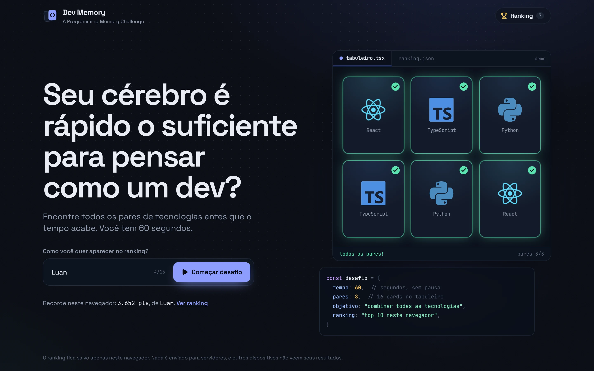
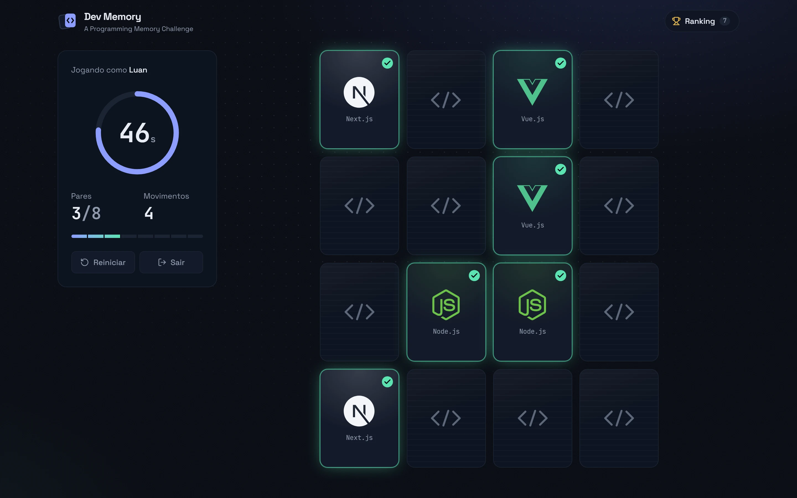
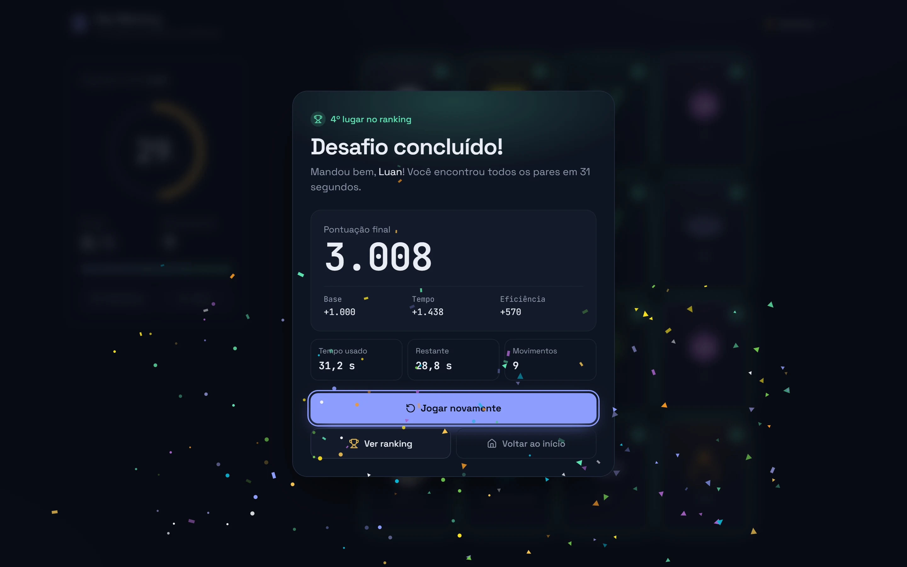
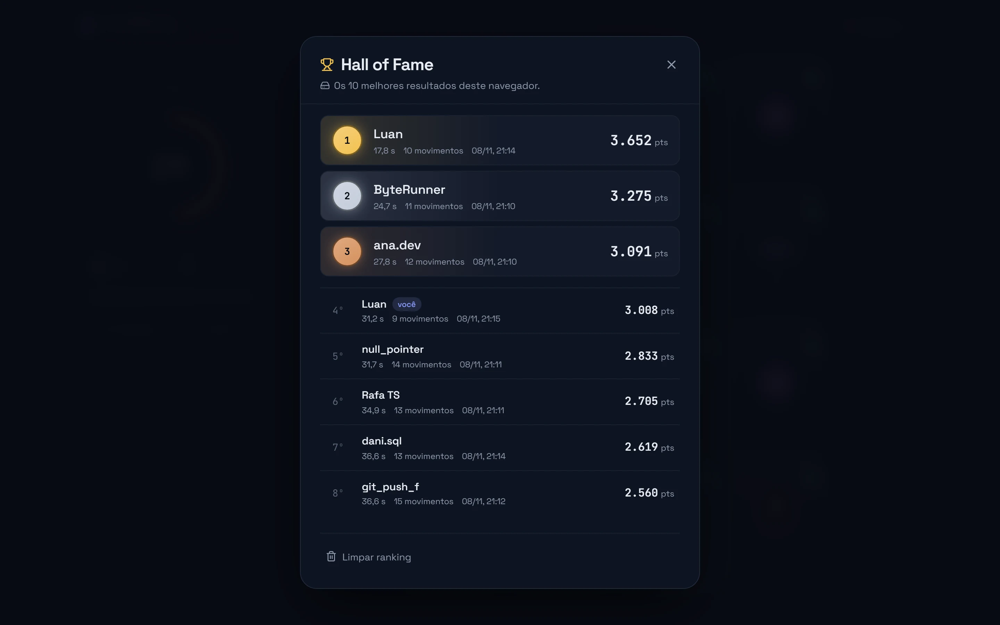
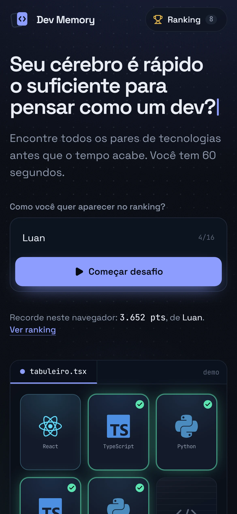
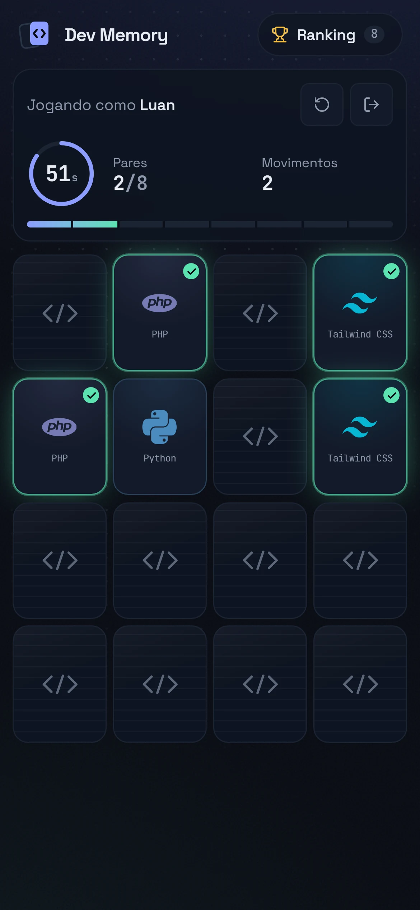
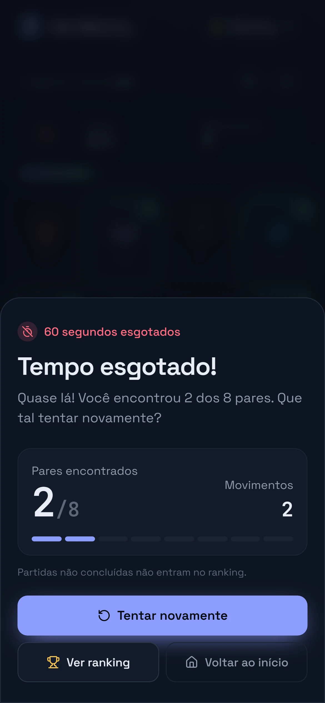

<div align="center">


# Dev Memory

**A Programming Memory Challenge**

Um jogo da memória com tecnologias de programação. Encontre os 8 pares em 60 segundos e entre para o Hall of Fame.


<br />



</div>

---

## Sumário

- [Sobre o projeto](#sobre-o-projeto)
- [Screenshots](#screenshots)
- [Funcionalidades](#funcionalidades)
- [Tecnologias](#tecnologias)
- [Como executar](#como-executar)
- [Arquitetura](#arquitetura)
- [Regras e lógica do jogo](#regras-e-lógica-do-jogo)
- [Sistema de pontuação](#sistema-de-pontuação)
- [Ranking local](#ranking-local)
- [Design e animações](#design-e-animações)
- [Acessibilidade e responsividade](#acessibilidade-e-responsividade)
- [Limitações conhecidas](#limitações-conhecidas)
- [Autor](#autor)

## Sobre o projeto

O Dev Memory é uma aplicação de página única feita para ser rápida, competitiva e bonita em qualquer tela. O jogador informa um nickname, recebe um tabuleiro 4×4 com 16 cards de linguagens, frameworks e bancos de dados, e tem exatamente 60 segundos para combinar todos os pares.

As vitórias entram em um ranking com os 10 melhores resultados, salvo no próprio navegador. Não há backend, cadastro ou chamadas de rede: depois de carregado, o jogo funciona offline.

A identidade visual se inspira em editores de código e ferramentas para desenvolvedores: fundo azul-marinho profundo, um único tom de destaque, tipografia monoespaçada nos números e a demonstração da tela inicial apresentada como um arquivo aberto em um editor.

## Screenshots

<table>
  <tr>
    <td width="50%"></td>
    <td width="50%"></td>
  </tr>
  <tr>
    <td align="center"><sub>Partida em andamento: cronômetro, pares, movimentos e progresso</sub></td>
    <td align="center"><sub>Vitória: pontuação detalhada e posição no ranking</sub></td>
  </tr>
  <tr>
    <td colspan="2"></td>
  </tr>
  <tr>
    <td colspan="2" align="center"><sub>Hall of Fame: pódio com medalhas e destaque para o resultado mais recente</sub></td>
  </tr>
</table>

<table>
  <tr>
    <td width="33%"></td>
    <td width="33%"></td>
    <td width="33%"></td>
  </tr>
  <tr>
    <td align="center"><sub>Início</sub></td>
    <td align="center"><sub>Partida</sub></td>
    <td align="center"><sub>Tempo esgotado</sub></td>
  </tr>
</table>

## Funcionalidades

- **Identificação simples:** apenas nome ou nickname, com limite de 16 caracteres, remoção de espaços extras e validação de campo vazio. O último nome usado vem preenchido.
- **Tabuleiro sorteado:** a cada partida, 8 das 16 tecnologias são sorteadas, duplicadas e embaralhadas. A disposição nunca repete a da partida anterior.
- **Cronômetro preciso:** contagem regressiva baseada em timestamps reais, com mudança de cor em 30 s e 15 s e pulsação nos últimos 5 s.
- **Feedback a cada jogada:** giro 3D ao virar, brilho e salto ao acertar, tremor e borda vermelha ao errar.
- **Vitória e derrota:** confetes, contagem animada da pontuação e posição no ranking; na derrota, o tabuleiro revela os cards restantes.
- **Hall of Fame:** top 10 persistente, pódio com ouro, prata e bronze, estado vazio e limpeza com confirmação.
- **Reinício instantâneo:** nova partida sem recarregar a página, com estado totalmente zerado.

## Tecnologias

| Camada | Escolha | Motivo |
| --- | --- | --- |
| Interface | [React 18](https://react.dev) | Componentes e estado previsível |
| Linguagem | [TypeScript](https://www.typescriptlang.org) (`strict`) | Tipagem do estado do jogo e do ranking |
| Build | [Vite](https://vite.dev) | Dev server rápido e build estático |
| Estilo | [Tailwind CSS 4](https://tailwindcss.com) | Tokens de design via `@theme` e utilitários responsivos |
| Animações | [Motion](https://motion.dev) + CSS | Transições de tela e modais; flip 3D em CSS puro |
| Ícones de UI | [Lucide](https://lucide.dev) | Ícones consistentes e leves |
| Logotipos | [Simple Icons](https://simpleicons.org) | SVGs das marcas empacotados no bundle |
| Fontes | [Fontsource](https://fontsource.org) | Space Grotesk e JetBrains Mono servidas localmente |

## Como executar

**Pré-requisito:** Node.js 20.19 ou superior.

```bash
git clone https://github.com/LuanGomes99/devmemory.git
cd devmemory
npm install
npm run dev
```

Acesse `http://localhost:5173`.

| Script | Descrição |
| --- | --- |
| `npm run dev` | Inicia o servidor de desenvolvimento |
| `npm run build` | Verifica os tipos e gera o build de produção em `dist/` |
| `npm run preview` | Serve o build de produção localmente |
| `npm run typecheck` | Executa apenas a checagem de tipos |

O conteúdo de `dist/` é estático e pode ser publicado em qualquer hospedagem de arquivos (Vercel, Netlify, GitHub Pages, Cloudflare Pages).

## Arquitetura

A lógica do jogo fica isolada em hooks; os componentes só recebem estado e disparam ações.

```
src/
├── App.tsx                 # Orquestra telas, modais e o registro de resultados
├── components/
│   ├── HomeScreen.tsx      # Tela inicial: título, formulário, demo e regras
│   ├── DemoBoard.tsx       # Demonstração automática da mecânica
│   ├── ChallengeSpec.tsx   # Regras exibidas como objeto de configuração
│   ├── PlayerForm.tsx      # Validação do nickname
│   ├── GameScreen.tsx      # Layout da partida e anúncios para leitores de tela
│   ├── GameBoard.tsx       # Grade 4×4 com navegação por setas
│   ├── MemoryCard.tsx      # Card com flip 3D e estados visuais
│   ├── GameStats.tsx       # Jogador, cronômetro, pares, movimentos e ações
│   ├── Timer.tsx           # Anel de contagem regressiva com faixas de urgência
│   ├── ResultModal.tsx     # Vitória e derrota
│   ├── RankingModal.tsx    # Hall of Fame
│   ├── Modal.tsx           # Diálogo acessível (foco preso, Esc, pilha de modais)
│   └── Confetti.tsx        # Partículas em canvas, sem dependências
├── hooks/
│   ├── useMemoryGame.ts    # Máquina de estados do jogo (useReducer)
│   ├── useCountdown.ts     # Cronômetro baseado em timestamps
│   └── useRanking.ts       # Leitura, gravação e sincronização do ranking
├── data/technologies.ts    # Banco de tecnologias, cores e ícones
├── utils/
│   ├── scoring.ts          # Fórmula de pontuação documentada
│   ├── ranking.ts          # Ordenação, validação e persistência
│   ├── storage.ts          # localStorage seguro com fallback em memória
│   ├── shuffle.ts          # Fisher–Yates com crypto.getRandomValues
│   └── format.ts           # Formatação pt-BR de números, tempos e datas
└── types/                  # Tipos do jogo e do ranking
```

## Regras e lógica do jogo

O estado da partida é uma máquina de estados (`idle → playing → won | lost`) implementada com `useReducer` em [`useMemoryGame.ts`](src/hooks/useMemoryGame.ts). Toda regra é aplicada no reducer, não apenas na interface:

| Situação | Comportamento |
| --- | --- |
| Clique durante a comparação de um par errado | Ignorado até os cards desvirarem (900 ms) |
| Clique no mesmo card duas vezes | Ignorado |
| Clique em card já encontrado | Ignorado |
| Clique depois do fim da partida | Ignorado |
| Clique que chega após os 60 s | Encerra a partida como derrota |
| Último par encontrado | Para o cronômetro no instante do clique |

### Cronômetro

Somar segundos com `setInterval` acumula erro e trava quando a aba fica em segundo plano. Por isso o tempo restante é sempre calculado a partir do momento de início:

```ts
restante = 60_000 − (performance.now() − inicio)
```

O intervalo serve apenas para atualizar a tela. Um `setTimeout` dedicado encerra a partida no instante exato, e o evento `visibilitychange` recalcula o tempo quando a aba volta ao foco. Veja [`useCountdown.ts`](src/hooks/useCountdown.ts).

## Sistema de pontuação

```
pontuação = 1000 + (tempo restante em segundos × 50) + bônus de eficiência
bônus de eficiência = max(0, 600 − (movimentos − 8) × 30)
```

| Componente | Faixa | Observação |
| --- | --- | --- |
| Base | 1000 | Concedida ao concluir os 8 pares |
| Tempo | 0 a 3000 | Usa frações de segundo, o que reduz empates |
| Eficiência | 0 a 600 | 8 movimentos é a partida perfeita; a partir de 28 o bônus é zero |

O tempo pesa mais porque é o desafio central. A eficiência tem teto baixo e nunca fica negativa, então não há incentivo para jogar devagar e evitar cliques. Máximo teórico: **4600 pontos**. Detalhes em [`scoring.ts`](src/utils/scoring.ts).

## Ranking local

- Salvo em `localStorage` na chave versionada `dev-memory-ranking-v1`.
- Somente vitórias são registradas, e cada partida só pode ser gravada uma vez (o id da partida é a chave).
- Ordenação: maior pontuação → menor tempo → menos movimentos → quem registrou primeiro.
- Apenas os 10 melhores são armazenados.
- Na leitura, itens corrompidos, incompletos, fora dos limites ou duplicados são descartados e a versão limpa é regravada.
- Se o `localStorage` estiver indisponível (modo privado restrito, cota cheia), o ranking passa a viver em memória e a interface avisa.
- Abas abertas ao mesmo tempo ficam sincronizadas pelo evento `storage`.

## Design e animações

- **Tokens:** cores, fontes e animações definidos em `@theme` no [`index.css`](src/index.css).
- **Tipografia:** Space Grotesk para a interface e JetBrains Mono para cronômetro, contadores e trechos de código.
- **Cores:** acento azul-lavanda; verde reservado para acertos, âmbar e vermelho para urgência do cronômetro.
- **Animações:** flip 3D em CSS, entradas escalonadas com Motion, onda de celebração no tabuleiro e confetes em canvas.
- **Movimento reduzido:** com `prefers-reduced-motion`, o giro vira um fade curto, os confetes e a pulsação são desativados e a demo da tela inicial fica estática.

## Acessibilidade e responsividade

- Cards são botões com rótulos descritivos; setas, `Home` e `End` navegam pela grade.
- Modais com foco preso, `Esc` para fechar e devolução do foco ao elemento de origem.
- Região `aria-live` anuncia acertos, erros e o fim da partida.
- O tabuleiro é dimensionado pela largura **e** pela altura da tela, então cabe inteiro sem rolagem nem zoom.
- Layout validado de 320 px a 2560 px, incluindo celular na horizontal (painel lateral) e escala tipográfica para telas 2K e 4K.
- Sem rolagem horizontal em nenhum tamanho testado.

## Limitações conhecidas

- O ranking pertence ao navegador em que o jogo foi aberto e não sincroniza entre dispositivos.
- Por ser 100% client-side, o ranking pode ser editado por quem usar o DevTools.
- O Simple Icons não distribui os logotipos oficiais de Java e C#: o card de Java usa o ícone do OpenJDK e o de C# é desenhado localmente.

## Autor

Desenvolvido por **Luan Gomes**.

[](https://github.com/LuanGomes99)
